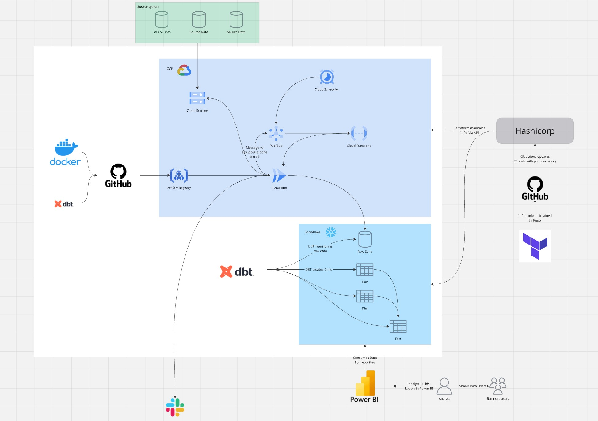

# Cloud Data Orchestration Platform

## Overview

A production-ready, cloud-native data orchestration platform built on **Google Cloud Platform** that provides comprehensive end-to-end data pipeline management from ingestion to transformation with intelligent AI-powered monitoring, error analysis, and automated alerting.

### Key Features
- **Intelligent Orchestration**: Configuration-driven scheduling with dependency-aware execution
- **AI-Powered Monitoring**: Advanced error analysis using Gemini 2.5 Pro with multi-role analysis
- **Comprehensive Logging**: Combined orchestrator and dbt logs with automatic GCS archival
- **Real-time Alerts**: Smart Slack notifications with deduplication and context-aware messaging
- **Advanced Analytics**: BigQuery integration for error trend analysis and operational insights
- **Production Ready**: Fully containerized with enterprise-grade CI/CD pipelines
- **Cloud Native**: GCP-native architecture eliminating external dependencies

---

## Architecture Overview



---

## Project Structure

```
├── 📂 orchestrator/jobs/          # Core Data Pipeline Jobs
│   ├── bigquery_ingestion/        # GCS → BigQuery parallel ingestion
│   └── transform_dbt/             # dbt orchestration with dependencies
├── 📂 functions/                  # Serverless Cloud Functions
│   ├── run_job/                   # Scheduled job triggers via Pub/Sub
│   ├── run_manual_job/            # Manual job execution endpoints
│   └── run_transform/             # Post-ingestion transformation triggers
├── 📂 services/log_agent/         # AI-Powered Monitoring Service
│   ├── clients/                   # Gemini AI integration & scoring
│   ├── utils/                     # Log parsing, storage & notifications
│   │   ├── dbt_log_parser.py      # Advanced dbt log analysis
│   │   ├── bq_storage.py          # BigQuery error tracking
│   │   └── slack_monitoring.py    # Intelligent Slack notifications
│   └── main.py                    # GCS-triggered log processing
├── 📂 snow_wh/                    # dbt Analytics Project
│   ├── models/                    # Layered data transformations
│   │   ├── staging/               # Raw data cleaning & validation
│   │   ├── intermediate/          # Business logic & joins
│   │   └── consume/               # Analytics-ready dimensions & facts
│   ├── macros/                    # Reusable SQL transformations
│   └── tests/                     # Data quality validations
├── 📂 config/                     # Environment Management
│   ├── base.py                    # Pydantic settings with validation
│   ├── dev.py                     # Development environment config
│   └── logging.py                 # Enhanced logging with file output
├── 📂 utils/                      # Shared Utilities
│   ├── job_registry.py            # Dynamic job discovery system
│   ├── job_scheduler.py           # Dependency resolution engine
│   ├── dbt_runner.py              # dbt execution wrapper
│   └── common.py                  # Log combination & GCS utilities
└── 📂 .github/workflows/          # Production CI/CD Pipelines
    ├── env-dev.yaml               # Multi-service deployment
    └── template-*.yaml            # Reusable workflow components
```

---

## Core Components Deep Dive

### **Orchestration Engine**
**Location**: `orchestrator/jobs/`

**BigQuery Ingestion Pipeline**:
- Parallel file processing with configurable thread pools
- Automatic table schema detection and validation
- Pub/Sub completion notifications for downstream triggers
- Comprehensive error handling with detailed logging

**dbt Transformation Orchestrator**:
- Advanced dependency resolution with topological sorting
- Multi-environment support (dev/staging/prod)
- Intelligent job registry with dynamic discovery
- Combined log aggregation for comprehensive debugging

### **AI-Powered Log Analysis**
**Location**: `services/log_agent/`

**Advanced Features**:
- **Multi-Role AI Analysis**: Tests different AI personas (engineer, data scientist, analyst) and selects best response
- **Sophisticated Log Parsing**: Extracts test failures, runtime errors, compilation issues, and metadata
- **Smart Scoring System**: Evaluates AI responses for quality and actionable insights
- **Context-Aware Notifications**: Includes failing nodes, error snippets, and suggested remediation
- **Deduplication Logic**: Prevents alert spam with intelligent error signature matching

**Supported Log Types**:
- dbt test failures with detailed context
- Runtime compilation errors
- Database connection issues
- Model execution failures
- Dependency resolution problems

### **Serverless Functions**
**Location**: `functions/`

**Scheduled Execution** (`run_job/`):
- Pub/Sub triggered job orchestration
- Dynamic Cloud Run job parameter injection
- Multi-region deployment support
- Comprehensive error propagation

**Manual Triggers** (`run_manual_job/`):
- HTTP endpoints for on-demand execution
- Flexible parameter override system
- Authentication and authorization ready
- Detailed execution logging

**Pipeline Coordination** (`run_transform/`):
- Event-driven transformation triggers
- Post-ingestion job chaining
- Status-based conditional execution
- Cross-service communication

### **Data Transformation Layer**
**Location**: `snow_wh/`

**Modern dbt Architecture**:
- **Staging Layer**: Raw data cleaning with character encoding fixes
- **Intermediate Layer**: Business logic with incremental processing
- **Consume Layer**: Analytics-ready star schema design
- **Advanced Macros**: Reusable transformations and utility functions
- **Comprehensive Testing**: Data quality validations at every layer

---

## Configuration Examples

### **Pipeline Job Definition**
```yaml
# orchestrator/jobs/transform_dbt/settings.yaml
schedule:
  daily:
    - name: refresh_staging
      run_job_name: dbt-transform-job
      region: us-central1
      environment: dev
      config:
        DBT_COMMAND: build
        DBT_MODELS: tag:staging
        DBT_TARGET: dev

    - name: refresh_facts
      depends_on: refresh_dimensions  # Smart dependency resolution
      run_job_name: dbt-transform-job
      region: us-central1
      environment: dev
      config:
        DBT_COMMAND: build
        DBT_MODELS: tag:fact
        DBT_TARGET: dev
        DBT_FULL_REFRESH: false
```

### **Advanced Configuration**
```python
# config/base.py - Pydantic validation
class Settings(BaseSettings):
    GEMINI_MODEL: str = "gemini-2.5-pro-preview-05-06"
    GCS_LOG_BUCKET: str  # Automatic log archival
    SLACK_WEBHOOK_URL: str  # Intelligent notifications
    TABLE_ERROR_SUMMARY: str = "error_summary"  # Error analytics
```

### **Manual Job Execution**
```json
{
    "run_job_name": "cloud-scheduler-cloudrun-job-transform-dbt",
    "region": "us-central1",
    "overrides": {
        "JOB_NAME": "refresh_facts",
        "SCHEDULE": "daily"
    }
}
```

---

## Development & Deployment

### **Quick Start**

1. **Environment Setup**
   ```bash
   # Load environment variables (PowerShell)
   Get-Content .env | ForEach-Object {
     if ($_ -match "^\s*([^#][^=]+?)\s*=\s*(.*)\s*$") {
       $key, $val = $matches[1], $matches[2]
       [System.Environment]::SetEnvironmentVariable($key, $val, "Process")
     }
   }

   ```

2. **For local python development, ensure you have the following**

      ```python
   # .env file with credentials saved and this at the top of the files being tested
      from dotenv import load_dotenv
      load_dotenv()
      ```

3. **Local Development**
   ```bash
   # Test dbt transformations with enhanced logging
   python orchestrator/jobs/transform_dbt/main.py

   # Test ingestion pipeline
   python orchestrator/jobs/bigquery_ingestion/main.py

   # Test AI log analysis (local mode)
   python services/log_agent/main.py
   ```

4. **Production Deployment**
   ```bash
   # Deploy entire platform
   gh workflow run "Deploy Dev"

   # Deploy specific components
   gh workflow run "Deploy Dev" --ref feature/new-monitoring
   ```

### **Code Quality & Testing**

**Automated Quality Gates**:
- **Static Analysis**: `mypy` for type safety with comprehensive coverage
- **Code Formatting**: `black` + `isort` with consistent styling
- **Linting**: `flake8` with custom rules for data engineering
- **Pre-commit Hooks**: Automated quality checks on every commit
- **Type Annotations**: Full typing coverage for better maintainability

**Testing Strategy**:
- TBA

---

## Production Features

### **Advanced Monitoring & Observability**

**Comprehensive Log Management**:
- **Structured Logging**: JSON-formatted logs with consistent metadata
- **Automatic Archival**: Combined orchestrator + dbt logs uploaded to GCS
- **Error Trend Analysis**: BigQuery storage for operational insights
- **Performance Tracking**: Execution time monitoring and optimization alerts

**AI-Powered Error Analysis**:
- **Multi-Role Evaluation**: Different AI personas analyze the same error
- **Quality Scoring**: Automatic assessment of AI response usefulness
- **Context Preservation**: Full error context including log snippets and failing nodes
- **Smart Deduplication**: Prevents notification spam while ensuring critical alerts

### **Security & Compliance**

**Enterprise Security**:
- **IAM Integration**: Fine-grained permissions with service account isolation
- **Secrets Management**: Secure credential handling via Google Secret Manager
- **Environment Isolation**: Complete separation between dev/staging/prod
- **Audit Logging**: Complete operational audit trail with BigQuery storage

**Data Governance**:
- **Schema Validation**: Automatic data quality checks at ingestion
- **Lineage Tracking**: Complete data lineage through dbt documentation
- **Access Control**: Role-based access to data and pipeline operations
- **Retention Policies**: Configurable data retention with automated cleanup

### **Scalability & Performance**

**Horizontal Scaling**:
- **Parallel Processing**: Multi-threaded ingestion with configurable workers
- **Auto-scaling**: Cloud Run automatic scaling based on demand
- **Resource Optimization**: Dynamic resource allocation per job type
- **Cost Management**: Efficient resource usage with automatic cleanup

**Performance Optimizations**:
- **Incremental Processing**: Smart data refresh strategies in dbt
- **Partition Strategy**: Optimized BigQuery table structures
- **Caching**: Intelligent dependency caching for faster builds
- **Monitoring**: Comprehensive performance metrics and alerting

---

## Advanced Use Cases

### **Enterprise Data Platform**
**Perfect For**:
- **Complex Dependencies**: Multi-team data pipelines with intricate relationships
- **High-Volume Processing**: Terabyte-scale data transformations
- **Regulatory Compliance**: Audit trails and data governance requirements
- **Multi-Environment**: Isolated dev/staging/prod with promotion workflows

### **Departmental Analytics**
**Ideal For**:
- **Self-Service Analytics**: Business users with configuration-driven workflows
- **Rapid Development**: Quick iteration cycles with comprehensive testing
- **Cost Optimization**: Pay-per-use serverless architecture
- **Collaborative Development**: Version-controlled configurations and shared utilities

### **Data Science Workflows**
**Optimized For**:
- **Feature Engineering**: Sophisticated data transformations with dbt
- **Model Training**: Automated data preparation for ML pipelines
- **Experiment Tracking**: Comprehensive logging and version control
- **Production ML**: Reliable data pipelines for model serving

---

## Technology Stack

| Layer | Technology | Purpose | Key Benefits |
|-------|------------|---------|--------------|
| **Orchestration** | Cloud Run + Cloud Functions | Serverless execution | Auto-scaling, cost-effective |
| **Scheduling** | Cloud Scheduler + Pub/Sub | Event-driven triggers | Reliable, decoupled architecture |
| **Data Platform** | BigQuery + GCS | Analytics & storage | Petabyte-scale, serverless |
| **Transformations** | dbt Core 1.7+ | SQL-based modeling | Version control, testing, docs |
| **AI Analysis** | Gemini 2.5 Pro | Error intelligence | Multi-role analysis, scoring |
| **Monitoring** | Cloud Logging + BigQuery | Observability | Structured logs, trend analysis |
| **Notifications** | Slack API | Real-time alerting | Context-aware, deduplication |
| **Infrastructure** | Terraform | IaC management | Reproducible deployments |
| **CI/CD** | GitHub Actions | Automation | Multi-environment, quality gates |

---

## Roadmap & Future Enhancements

### **Planned Features**

- **Advanced Retry Logic**: Exponential backoff with intelligent failure classification
- **Data Quality Framework**: Automated anomaly detection and data profiling
- **Multi-Cloud Support**: AWS and Azure integration capabilities
- **Visual Pipeline Builder**: Web UI for non-technical pipeline management
- **Advanced ML Integration**: AutoML model training integration
- **Real-time Streaming**: Support for continuous data processing
- **Workflow Orchestration**: Complex multi-step pipeline support with branching
- **Advanced Analytics**: Machine learning-powered operational insights
- **Enterprise SSO**: Complete authentication and authorization framework

---

## License & Attribution

**MIT License** - See [LICENSE](LICENSE) file for details.

**Built by [Aaron Sime](https://github.com/aaronsime)** - Designed for modern data teams who need enterprise-grade orchestration without enterprise-grade complexity.

---

**Infrastructure**: For GCP infrastructure setup, see the companion repository: [cloud-platform-gcp-tf](https://github.com/aaronsime/cloud-platform-gcp-tf)*
